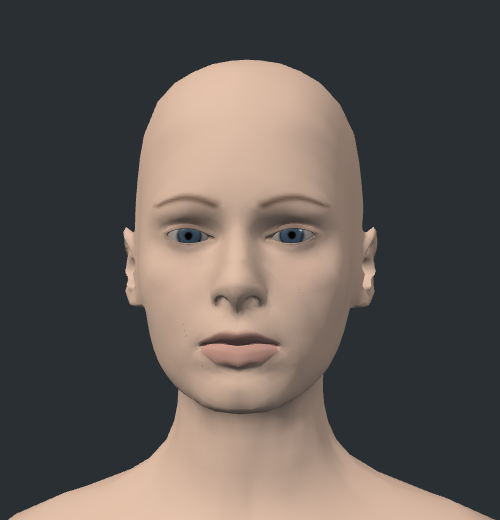

# Поиск старой голубоглазой модели

В истории проекта нашлись два разных старых женских персонажа с голубыми глазами. Это **кандидаты для узнавания**, а не утверждение, что найден именно тот вариант, который вы имели в виду. Никакие модели и колодец не изменялись; новые здесь только снимки экрана.

## Вариант А — модель из архива 13 ноября

Более подробная модель с голубыми глазами, сохранённая до последней переделки. Снимок сделан в исходной витрине, затем кадрирован:

[В полный рост](candidate-a-full.png) · [Сзади](candidate-a-back.png)

- [Скачать исходный GLB](https://github.com/IAmStarhead/Blades-Of-War/raw/b093a0052a6be080d0364c8a5136cf74ae53dff3/assets/models/female_fixed.glb)
- [Исходный архив с витриной и моделью](https://github.com/IAmStarhead/Blades-Of-War/blob/b093a0052a6be080d0364c8a5136cf74ae53dff3/BladesOfWar_%D0%B8%D1%81%D0%BF%D1%80%D0%B0%D0%B2%D0%BB%D0%B5%D0%BD%D0%BD%D0%B0%D1%8F_%D0%BC%D0%BE%D0%B4%D0%B5%D0%BB%D1%8C.zip)
- [Коммит от 13 ноября 2026](https://github.com/IAmStarhead/Blades-Of-War/commit/b093a0052a6be080d0364c8a5136cf74ae53dff3)

В этой версии GLB модель статичная: скелета и анимационных клипов в файле нет. Проверенный SHA-256 исходной модели: `23428079f47cf54b2a5dc9b4dc7799dbc7afb27a06f8f1a67a69972dc593f7ec`.

## Вариант Б — другая стилизованная версия

Позднее в тот же день была сохранена другая, более низкополигональная голубоглазая модель. Снимок — из её исходного редактора с настройками по умолчанию:

- [Скачать исходный GLB](https://github.com/IAmStarhead/Blades-Of-War/raw/f884ef2bcc698f857d5b676e6a53d9c0c5a1e1fb/assets/models/female_styled.glb)
- [Исходный архив с редактором и моделями](https://github.com/IAmStarhead/Blades-Of-War/blob/f884ef2bcc698f857d5b676e6a53d9c0c5a1e1fb/BladesOfWar_styled_creator.zip)
- [Коммит от 13 ноября 2026](https://github.com/IAmStarhead/Blades-Of-War/commit/f884ef2bcc698f857d5b676e6a53d9c0c5a1e1fb)

У этой версии есть скелет, но отдельных клипов анимации в GLB нет.
