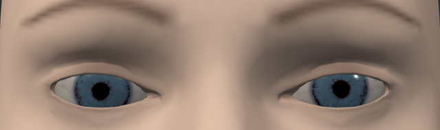
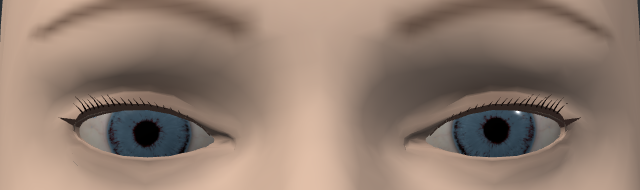

# Женщина А — предыдущая проба ресниц

> **Последняя согласованная версия:** [модель А с линиями век без стрелок, увеличенной грудью и подробным колодцем](refined-v2/). Рядом сохранены отдельные пробы: [кожа и свет](relief-study/) и [брови, моргание и кулаки](motion-study/); они не заменяют предыдущие версии. [Предыдущая версия со стрелками](refined/) и материалы ниже оставлены для сравнения.

За основу взята выбранная модель А из старого архива. Добавлены **отдельные объёмные верхние ресницы**: тёмная линия по веку и вытянутые внешние уголки в стиле «кошачий глаз», по мотивам присланных примеров. Это проба на оценку, а не изменение формы лица под изображения-референсы.

## Посмотреть на GitHub

До:

После:

[Лицо спереди](review/face-after.png) · [Лицо в три четверти](review/angle-after.png) · [В полный рост](review/figure-after.png) · [Лицо до добавления ресниц](review/face-before.png)

Снимки «до» и «после» сделаны с одинаковой камерой и освещением исходной витрины.

## Скачать и открыть в 3D

- [Архив со старой автономной витриной и обеими версиями модели](female_A_with_lashes_showcase.zip?raw=1)
- [Отдельная модель с ресницами — GLB](female_A_with_lashes.glb?raw=1)

Распакуйте архив и откройте `BladesOfWar_Showcase.html` в браузере с поддержкой WebGL. На GitHub HTML не запускается интерактивно. Вкладка **«Женщина — исправлено»** показывает модель А с ресницами. Файл `female_A_original.glb` в архиве — исходная А без ресниц; вкладка «Женщина — прошлая проба» показывает другую историческую пробу.

**Важно:** это витрина из старого архива модели А. В ней показаны исторические версии мужчины и колодца, а не последняя сцена проекта. Текущий колодец в репозитории не менялся.

## Что сохранено

- Форма тела и лица, в том числе ягодиц, не изменялась; исходные геометрия и текстуры глаз и тела сохранены побайтово. Причесок не добавляли.
- В исторической витрине мужские модели, другая женская проба и код старого колодца не изменены. Её исходный HTML отличается только встроенной женской моделью.
- Ресницы — отдельный объект `upper_lashes_cat_eye`, его можно удалить или скрыть в 3D-редакторе. Скелета, анимаций и морфов мимики у этой версии нет; автоматически моргать ресницы не будут.
- Исходная модель: [коммит b093a005](https://github.com/IAmStarhead/Blades-Of-War/blob/b093a0052a6be080d0364c8a5136cf74ae53dff3/assets/models/female_fixed.glb). В архиве также сохранён оригинальный README со сведениями о лицензии основы.

Проверено: целостность архива, отсутствие ошибок и предупреждений glTF Validator, открытие витрины без сети и работа режимов. Сборка и проверки описаны [здесь](../../../tools/model-a-lashes/README.md).
