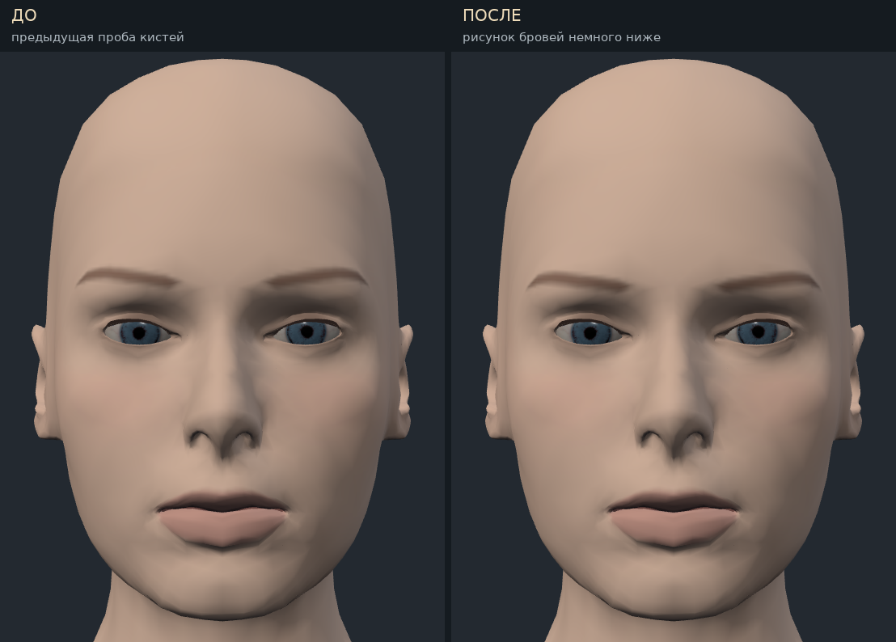

# Ева А — отдельная проба рисунка бровей

Поверх [последней пробы кистей](../fist-refinement-trial/) немного опущен **рисунок обеих бровей на текстуре**, тем же способом, что и в предыдущей правке. Геометрия и рельеф лица не менялись. Уши, открытые кисти, моргание и проба сгиба сохранены. Прежняя модель и архив не перезаписаны.

## Сравнить

Снимки сделаны с одинаковыми камерой и освещением из настоящих 3D-моделей, без дорисовки.

[Крупно: брови и глаза](review/03-brows-close.png) · [Ракурс три четверти](review/02-angle.png)

## Открыть модель

- [Автономная витрина с Евой и колодцем — ZIP](female_A_brows_lower_and_well.zip?raw=1)
- [Отдельная модель с морфами и клипами — GLB](female_A_brows_lower.glb?raw=1)
- [Предыдущая проба кистей — без замены](../fist-refinement-trial/)

Распакуйте ZIP и откройте `BladesOfWar_Showcase.html` в браузере с WebGL. Интернет не нужен. Выберите **«Женщина А»** и **«Лицо крупно»**. Мышь вращает камеру, колесо меняет масштаб; на телефоне вращайте пальцем и масштабируйте двумя.

Моргание, флажок **«Кулаки»** и ползунок сгиба работают как прежде. В GLB есть клипы `Blink_Once`, `Fists_Close` и `Fists_Open`; для ручного управления используются все четыре веса сгиба, как описано в [предыдущей пробе](../fist-refinement-trial/#для-использования-в-игре).

**Это не боевой риг:** скелета в текущем GLB нет, руки сжимаются одновременно заранее запечёнными морфами. Для проверки кулаков в драке потребуются отдельно созданные движения и риг. В исходной открытой сетке есть локальные самопересечения у основания больших пальцев; проверка пересечений предыдущей пробы была выборочной. Причёска не добавлена; колодец и свет не менялись.

Структурная проверка подтвердила побайтовую неизменность геометрии и данных анимации; glTF Validator — **0 ошибок и 0 предупреждений**. Детали сборки и проверок — в [описании инструмента](../../../../tools/model-a-brow-study/README.md).
