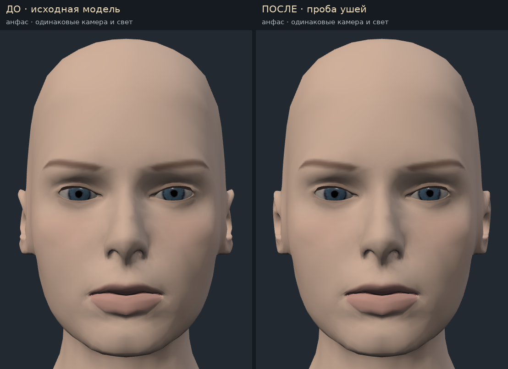
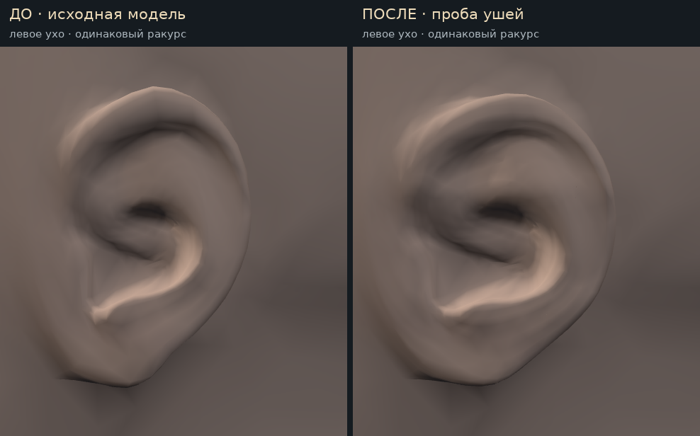

# Героиня — отдельная проба формы ушей

Это **проба для оценки**, а не утверждённая окончательная внешность. На отдельной копии [модели с доработанными глазами](../eye-study/) контур ушей анфас сделан спокойнее, верх и мочка смягчены, внутренние складки сохранены; уши также немного раскрыты наружу. Пропорции лица, глаза и прежние формы кистей не переделывались. Исходный GLB и его витрина сохранены без замены.

## Сравнение до и после





[Крупный фрагмент анфас](review/02-front-ear-detail.png) · [Правое ухо](review/04-right-ear.png) · [Три четверти](review/05-three-quarter.png) · [Сзади](review/06-back.png)

Это реальные снимки двух GLB из автономных витрин при одинаковых камерах и освещении, не нейросетевые иллюстрации. Они только одинаково обрезаны и подписаны; фрагмент анфас дополнительно увеличен в три раза без сглаживания. Рельеф и контур не дорисовывались. Художественное решение ещё нужно оценить с разных сторон.

## Скачать и открыть в 3D

- [Автономная витрина с героиней и колодцем — ZIP](female_A_ears_refined_and_well.zip?raw=1)
- [Отдельная модель — GLB](female_A_ears_refined.glb?raw=1)
- [Неизменённая исходная модель — GLB](../eye-study/female_A_eyes_refined.glb?raw=1)

Распакуйте ZIP и откройте `BladesOfWar_Showcase.html` в браузере с WebGL: интернет для просмотра не нужен. Витрина открывается на лице; кнопки **«Левое ухо»** и **«Правое ухо»** показывают уши сбоку. Мышью можно вращать и масштабировать сцену, на телефоне — пальцами. Доступны моргание, флажок **«Кулаки»** и ползунок сгиба кистей. На GitHub HTML отображается как код, поэтому витрину надо скачать и распаковать.

В отдельном GLB сохранены клипы `Blink_Once`, `Fists_Close` и `Fists_Open`. **Скелета и полноценного боевого рига нет**, как и волос, одежды и игровых анимаций. Сжатие обеих кистей — предварительный парный морф, не независимый риг пальцев; хват местами неплотный. Для управления промежуточными положениями нужны все четыре веса морфов: формулы приведены в `README.txt` внутри ZIP и в [описании прежней пробы кистей](../hand-ear-study/README.md#использование-в-игре-и-ограничения). Исходная открытая сетка имеет локальные самопересечения у оснований больших пальцев; прежние проверки кистей были выборочными.

Модель содержит **35 686 треугольников**, три материала и две встроенные текстуры 1024×1024 — столько же, сколько исходная модель. Замеров производительности в игре нет; размер GLB не равен расходу видеопамяти. Колодец находится внутри витрины и отдельно как GLB не приложен.

## Что проверено

- Изменены 3 118 вершин ушей и их соединения с головой, максимальное смещение — **5,288 мм**. Позиции и нормали вне области правки не изменены. UV, индексы, текстуры, материалы, глаза, морфы и анимационные буферы побайтно совпадают с исходником; новых полигонов нет.
- Парные изменения симметричны, прежде совпадавшие вершины UV-швов не разошлись; сваренная поверхность тела и лица замкнута. Минимальная площадь изменённой грани — 0,504 от исходной, максимальный поворот её нормали — 58,14°. Для 3 263 локальных треугольников с каждой стороны FCL не обнаружил несоседних самоконтактов ни до, ни после правки.
- Khronos glTF Validator: **0 ошибок, 0 предупреждений и 0 информационных сообщений** для исходного и нового GLB. В автономном Chromium проверены ракурсы ушей, моргание, переключатель и ползунок кистей, одновременное проигрывание клипов. На фронтальном рендере различия находятся у ушей и прилегающей кожи; центральная часть лица и контрольный рендер кулака совпали попиксельно.
- Проверки геометрии и поз выборочные: они не гарантируют отсутствие проблем во всех ракурсах, будущих позах или импортёрах и не заменяют художественное одобрение.

Основа и использованные формы MakeHuman/MPFB2 assets распространяются под **CC0 1.0 Universal**; [текст лицензии](../../../../tools/model-a-refinement/makehuman/LICENSE.ASSETS.md) также включён в архив. Фотографии людей использовались только как ориентиры и в модель не включены.

## Воспроизведение и QA

Нужны Python 3.11, Node.js 22, файлы проекта и указанные зависимости; `python-fcl` используется проверкой пересечений. Сборка и проверки после установки пакетов выполняются без сети. Для браузерной проверки Chromium может требовать системные библиотеки; при необходимости задайте `CHROME_BIN`. Команды ниже создают новую копию в `/tmp`, не перезаписывая выданный результат:

```bash
python3 -m venv /tmp/bow-ear-venv
. /tmp/bow-ear-venv/bin/activate
pip install -r tools/model-a-hand-ear/requirements.txt
npm ci --prefix tools/character-showcase
npm ci --prefix tools/model-a-motion

python tools/model-a-ear-study/build.py --output /tmp/bow-ear-rebuild
python tools/model-a-ear-study/qa.py --result /tmp/bow-ear-rebuild --rebuild
node tools/model-a-ear-study/qa-gltf.mjs /tmp/bow-ear-rebuild
PYTHON=python node tools/model-a-ear-study/review.mjs /tmp/bow-ear-rebuild
```

Сборщик проверяет SHA исходной модели, предка с разбиением ушей и файлов форм; он применяет локальные сглаженные смещения, симметризует их и проверяет границы, швы и грани. Один фронтальный ракурс служит ориентиром для контура, остальные ракурсы нужно оценивать отдельно. `qa.py` проверяет сохранённые данные, локальность, геометрию, выборочные FCL-контакты и архив; `--rebuild` дополнительно сравнивает байты повторной сборки. `review.mjs` открывает обе витрины без внешних запросов и создаёт снимки, а `review.py` их кадрирует и подписывает. Результаты повторения зависят от версий численных библиотек, сжатия и среды рендеринга.

Проверено в этой среде при Python 3.11.2, NumPy 2.4.6, SciPy 1.17.1, Pillow 13.0.0, python-fcl 0.7.0.11 и zlib 1.2.13:

- Исходный GLB: SHA-256 `69d3818596d67037445a87fcc89e6aeacccf035a97c218cf139d117444139d10`.
- Проба GLB: 3 851 104 байта, SHA-256 `531c2abfd67eccbcb21ab804f660abf533ce6d4f8091ecb8f17c222b15d3013d`.
- ZIP: 3 426 253 байта, SHA-256 `08648f2ea63c0ebc9d6497dfe17d5ea97e48c5cf7d630a91c6b5528425f330c5`.
- В этой среде GLB и ZIP воспроизведены побайтно.
