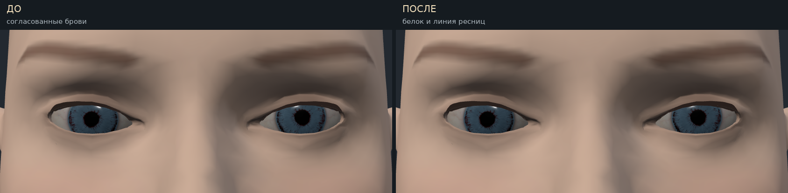

# Ева — отдельная проба белков и ресниц

Это небольшая правка поверх [Евы с согласованными бровями](../brow-study/), а не новая внешность. Ева остаётся общей женщиной по умолчанию, не закреплённой за каким-либо народом. Предыдущая модель и архив сохранены.

## Сравнение

[Один глаз крупно](review/02-eye-close.png) · [Фрагмент белка до и после](review/06-sclera-detail.png) · [Три четверти](review/03-angle.png) · [Моргание](review/04-blink.png) · [Лицо целиком](review/05-face.png)

Это реальные изображения из 3D-витрины с одинаковыми камерами и светом. Они кадрированы и подписаны; фрагмент белка дополнительно увеличен без сглаживания. Детали не дорисованы.

- **Белки:** голубые пятна найдены непосредственно в текстуре, в том числе на участках, обычно скрытых веками. Повреждённые пиксели заменены подходящими по тону участками старой текстуры с совпадающими UV из файлов проекта. Голубая радужка и зрачок не перекрашены; остальная текстура глаз сохранена.
- **Ресницы:** существующая непрерывная верхняя линия немного расширена и плавнее сужена на внутреннем конце; наружная стрелка не возвращалась. Это по-прежнему стилизованная линия, не отдельные волоски. Её морф подогнан к прежнему морганию.
- Геометрия лица, брови, кожа, уши, открытые кисти, формы и клипы кулаков сохранены; новые волосы не добавлялись.

## Открыть

- [Автономная витрина с Евой и колодцем — ZIP](female_A_eyes_refined_and_well.zip?raw=1)
- [Модель Евы — GLB](female_A_eyes_refined.glb?raw=1)
- [Три отдельные женские пробы на основе Евы и общая витрина](../../women-variants/)

Распакуйте ZIP и откройте `BladesOfWar_Showcase.html` в браузере с WebGL. Интернет не нужен. Выберите **«Женщина А»** и **«Лицо крупно»**. Мышью вращайте сцену и меняйте масштаб колесом; на телефоне вращайте пальцем и масштабируйте двумя. Кнопки **«Моргнуть»** и **«Закрыть глаза»**, флажок **«Кулаки»** и ползунок доступны как раньше.

В GLB есть клипы `Blink_Once`, `Fists_Close` и `Fists_Open`, но **скелета и боевого рига нет**. Пара кулаков — предварительный запечённый морф: сгиб ещё округлый, а хват местами неплотный. В исходной открытой сетке есть локальные самопересечения у оснований больших пальцев; прежние проверки были выборочными. Колодец и свет не изменены.

Проверены неизменность остальных данных, два глаза и 11 значений моргания, переключатели в автономном браузере; glTF Validator: **0 ошибок, 0 предупреждений**. Подробности и команды — [в описании сборщика](../../../../tools/model-a-eye-study/README.md).
