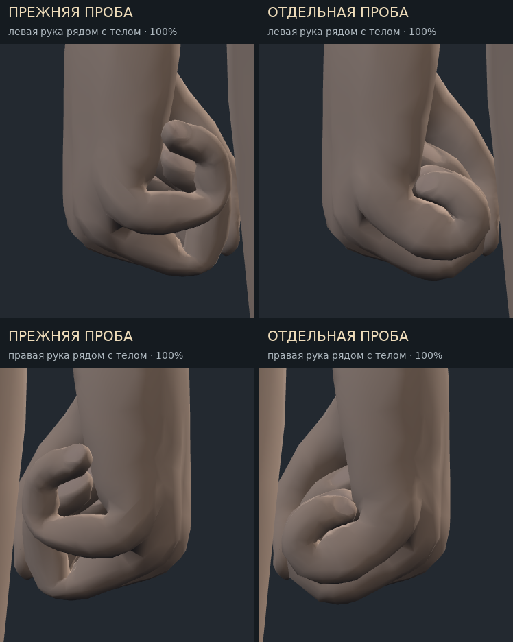

# Ева А — отдельная проба сгиба кистей

Это **экспериментальный вариант** [предыдущей пробы кистей и ушей](../hand-ear-study/): прежние файлы сохранены, одобренные уши не менялись. Изменены сгибы мизинцев и безымянных пальцев обеих рук; промежуточные формы анимации пересчитаны вместе с конечной позой. Открытая поза, лицо, моргание, материалы, свет и колодец сохранены.

В сравнении с предыдущим вариантом большая петля мизинца стала меньше. Но результат **ещё не идеальный кулак**: сгиб остаётся округлым, особенно заметен U-образный изгиб на промежуточных стадиях, пальцы выглядят неровно, а с некоторых ракурсов хват неплотный. Это проба для Вашей оценки, а не заявление, что анатомия полностью исправлена.

## Сравнение

На каждой паре показаны реальные снимки моделей с одинаковой камерой и светом; без дорисовки. Оба сравнения ниже сняты при 100% сгиба рядом с телом:



- [Левая кисть: до и после, 100%](review/01-left-side.png) · [Правая кисть: до и после, 100%](review/02-right-side.png)
- [Левая кисть: до и после, 75%](review/07-left-75.png) · [Правая кисть: до и после, 75%](review/08-right-75.png)
- [Левая кисть изнутри, 100%](review/03-left-palm.png) · [Правая кисть изнутри, 100%](review/04-right-palm.png)
- [Стадии сгиба левой кисти](review/05-left-movement.png) · [Стадии сгиба правой кисти](review/06-right-movement.png)

Для снимков изнутри и стадий кисть изолирована **только во время просмотра**; обрезанный край запястья не является изменением GLB.

## Открыть в 3D

- [Автономная витрина с Евой и колодцем — ZIP](female_A_fist_trial_and_well.zip?raw=1)
- [Отдельная модель с морфами и клипами — GLB](female_A_fist_trial.glb?raw=1)
- [Предыдущий вариант с одобренными ушами — без замены](../hand-ear-study/)

Распакуйте ZIP и откройте `BladesOfWar_Showcase.html` в браузере с WebGL: интернет не нужен. Выберите **«Женщина А»** и ракурс кисти. Флажок **«Кулаки»** плавно переключает обе кисти, а ползунок **«Сгиб кистей»** позволяет осмотреть весь переход. При 0% возвращается прежняя открытая поза. Мышь вращает камеру, колесо изменяет масштаб; на телефоне вращайте пальцем и масштабируйте двумя. Автоматическое моргание можно отключить.

## Для использования в игре

Клипы `Fists_Close` и `Fists_Open` для обеих рук длятся по 0,35 с, клип `Blink_Once` сохранён и работает отдельно. Используйте клипы целиком: один только морф `Fists` не воспроизводит показанный промежуточный путь. Если управлять сгибом вручную, при `f` от 0 до 1 задавайте **все четыре** веса тела:

```text
basemesh_female_body.Fists                      = f
basemesh_female_body.FistQuarterCorrection      = max(0, 1 - abs(f - 0.25) / 0.25)
basemesh_female_body.FistHalfCorrection         = max(0, 1 - abs(f - 0.50) / 0.25)
basemesh_female_body.FistThreeQuarterCorrection = max(0, 1 - abs(f - 0.75) / 0.25)
```

При `f=0` все веса нулевые, при `f=1` равен единице только `Fists`. Для моргания по-прежнему используются `face_blink.Blink = b`, `upper_eyelid_line.Blink = b` и `upper_eyelid_line.BlinkLineNarrow = min(1, 2*b)`. Удержание позы и автоматическое моргание зависят от импортёра или кода игры.

**В GLB нет скелета:** движение заранее запечено в морфы, это не риг с независимым управлением пальцами и не физическая симуляция. В исходной открытой сетке есть локальные самопересечения у основания больших пальцев; открытая геометрия сохранена. В 201 проверенном положении каждой руки новых пересечений среди выбранных поверхностей кисти и соседней ноги не обнаружено. Это выборочная проверка, а не гарантия для всех полигонов и моментов. glTF Validator: 0 ошибок, 0 предупреждений. Детали и воспроизводимая сборка — в [описании инструмента](../../../../tools/model-a-fist-trial/README.md).
