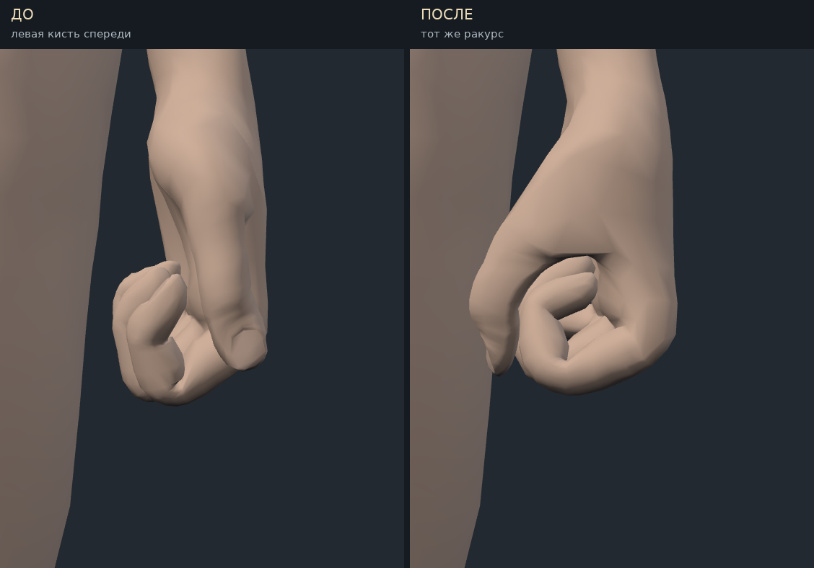
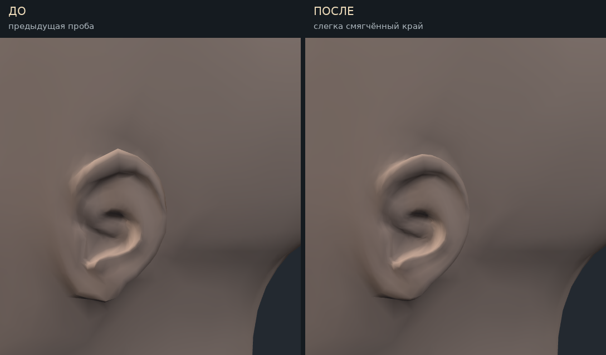

# Ева А — отдельная проба кистей и ушей

Это **отдельный вариант** [предыдущей пробы бровей, моргания и кулаков](../motion-study/), которая сохранена без замены. Для обеих кистей изменён сгиб пальцев и положение больших пальцев, чтобы хват выглядел естественнее; края ушей слегка сглажены. Открытые руки, лицо, глаза, брови, текстуры, моргание и остальная модель сохранены. Причёска не добавлена.

## Сравнить до и после

Это настоящие снимки 3D-модели: в каждой паре камера и свет одинаковы.





- [Обе кисти в сцене](review/03-both-hands.png) · [Левая кисть снаружи](review/04-left-hand.png) · [Правая кисть снаружи](review/05-right-hand.png)
- [Левая ладонь](review/07-left-palm.png) · [Правая ладонь](review/08-right-palm.png) · [Промежуточные положения сгиба](review/09-intermediate-hand.png). Для этих трёх снимков кисть изолирована только в проверочном просмотре; обрезанный край запястья не является изменением модели.
- [Левое ухо под другим углом](review/02-left-ear-angle.png) · [Правое ухо](review/10-right-ear.png) · [Ева в полный рост](review/figure-front.png) · [Сцена с прежним колодцем](review/scene-angle.png)

## Открыть в 3D

- [Скачать автономную витрину с Евой и колодцем — ZIP](female_A_hands_ears_and_well.zip?raw=1)
- [Скачать отдельную модель с морфами и клипами — GLB](female_A_hands_ears.glb?raw=1)
- [Предыдущая проба — без замены](../motion-study/)

Распакуйте ZIP и откройте `BladesOfWar_Showcase.html` в браузере с WebGL. Интернет не нужен. Выберите **«Женщина А»** и ракурс **«Кисти крупно»**, отдельную кисть или ухо. Флажок **«Кулаки»** плавно переключает обе кисти, а ползунок **«Сгиб кистей»** позволяет рассмотреть промежуточные положения. При 0% возвращается исходная открытая поза. Это мягкий хват, не физическая симуляция удержания предмета.

Моргание работает независимо: его можно запустить кнопкой, включить автоматически или удержать глаза закрытыми. При системном предпочтении уменьшенного движения автоморгание изначально выключено. Мышь вращает камеру, колесо меняет масштаб, правая кнопка сдвигает сцену; на телефоне вращайте пальцем и масштабируйте двумя. На GitHub HTML отображается как код, поэтому для интерактивного просмотра его нужно скачать и распаковать.

## Использование в игре и ограничения

В GLB сохранены клипы `Blink_Once`, `Fists_Close`, `Fists_Open`. Переход кистей использует **четыре** морф-цели; для корректных промежуточных положений воспроизводите клипы или управляйте всеми четырьмя весами одновременно. Для степени сгиба `f` от 0 до 1:

```text
basemesh_female_body.Fists                      = f
basemesh_female_body.FistQuarterCorrection      = max(0, 1 - abs(f - 0.25) / 0.25)
basemesh_female_body.FistHalfCorrection         = max(0, 1 - abs(f - 0.50) / 0.25)
basemesh_female_body.FistThreeQuarterCorrection = max(0, 1 - abs(f - 0.75) / 0.25)
```

При `f=0` все веса нулевые, при `f=1` равен единице только `Fists`. Одного плавного изменения `Fists` без корректировок недостаточно для показанного перехода. Для моргания по-прежнему используются `face_blink.Blink = b`, `upper_eyelid_line.Blink = b` и `upper_eyelid_line.BlinkLineNarrow = min(1, 2*b)`.

**Скелета в GLB нет:** это заранее подготовленное парное движение, а не риг с независимым управлением каждым пальцем. Режимы удержания позы и автоматического моргания зависят от игрового импортёра или кода игры. Уши локально получили дополнительные полигоны: общее число треугольников выросло с **31 066 до 35 686**; добавились данные морфов. Замеры производительности не проводились. Свет и колодец витрины сохранены; отдельного GLB колодца в архиве нет.

В исходной неизменённой открытой сетке уже есть локальные самопересечения у основания больших пальцев; в проверенных положениях они расходятся в начале сгиба. На 201 выбранном положении обеих рук новых пересечений среди проверенных поверхностей кисти и соседней ноги не обнаружено. Это **выборочная проверка**, а не гарантия отсутствия пересечений для всей сетки и каждого момента. Khronos glTF Validator: **0 ошибок и 0 предупреждений**. Подробные результаты, ограничения, сборка и проверки — в [описании инструмента](../../../../tools/model-a-hand-ear/README.md).
