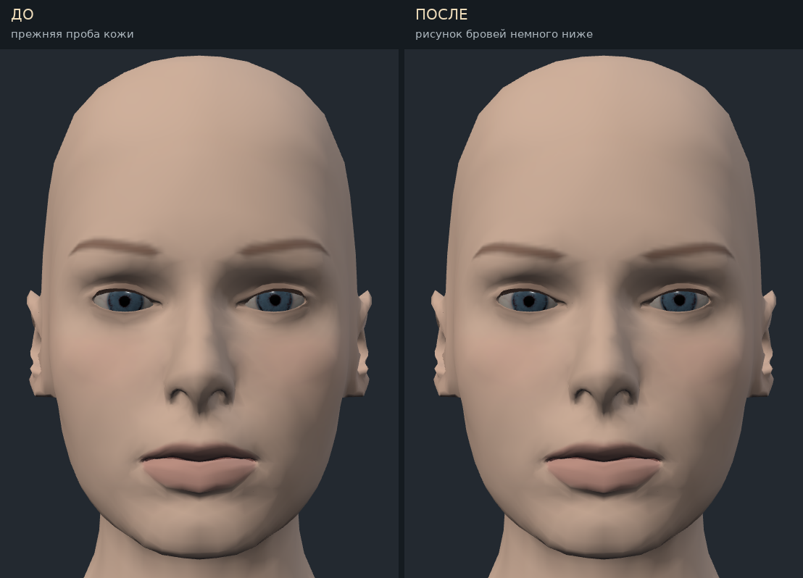

# Ева А — брови, моргание и кулаки

Это **отдельная проба** поверх [предыдущей версии кожи и света](../relief-study/): она не перезаписывает прежнюю модель или архив. Рисунок бровей немного опущен к рельефу; нейтральная геометрия лица и тела не менялась. Причёска пока не согласована и не добавлена.

## Посмотреть результат

Ниже — настоящие снимки модели, а не иллюстрация. В каждой паре камера и свет одинаковы.



- [Моргание: открытые и закрытые глаза](review/02-blink.png) · [В три четверти](review/05-blink-angle.png) · [Промежуточное положение век](review/eyes-half.png)
- [Левая кисть: открыта и слегка сжата](review/03-left-hand.png) · [Правая кисть](review/04-right-hand.png)
- [Ева в полный рост](review/figure-front.png) · [Общая сцена с колодцем](review/scene-angle.png) · [Колодец отдельно](review/well-angle.png)

## Открыть в 3D

- [Скачать автономную витрину с Евой и колодцем — ZIP](female_A_motion_and_well.zip?raw=1)
- [Скачать модель с морфами и клипами — GLB](female_A_motion.glb?raw=1)

Распакуйте ZIP и откройте `BladesOfWar_Showcase.html` в браузере с WebGL. Интернет не нужен. Выберите **«Женщина А»**, затем **«Лицо крупно»**, **«Кисти крупно»** или отдельную левую/правую кисть:

- **«Моргнуть»** запускает одно моргание, **«Автоморгание»** — периодические; **«Закрыть глаза для просмотра»** удерживает веки закрытыми. При системном предпочтении уменьшенного движения автоморгание изначально выключено.
- Флажок **«Кулаки»** плавно сжимает обе кисти; снимите флажок, чтобы вернуть исходную позу. Поза намеренно **слегка сжатая**, а не сильно зажатый кулак.
- Мышь вращает камеру, колесо меняет масштаб, правая кнопка сдвигает сцену. На телефоне вращайте пальцем, масштабируйте и сдвигайте двумя пальцами. Панель на небольших экранах находится ниже модели.

На GitHub HTML показывается как код, поэтому витрину нужно скачать и распаковать. Освещение остаётся настройкой витрины, а не GLB. Код колодца и прежний свет в режимах «Колодец» и «Вместе» сохранены; отдельного GLB колодца в архиве нет.

## Что именно переносится в игру

В GLB есть морф-цели и три коротких glTF-клипа: `Blink_Once`, `Fists_Close`, `Fists_Open`. Моргание и кулаки управляют разными узлами и могут воспроизводиться одновременно. Клипы запускаются **однократно**; чтобы удерживать кулаки или повторять моргание, нужно настроить воспроизведение в движке. Клипы закрытия и раскрытия кистей следует переключать по очереди и настроить удержание конечной позы; конкретная настройка зависит от импортёра.

Если управлять морфами вручную, для степени закрытия глаз `b` и сжатия кистей `f` от 0 до 1 используйте:

```text
face_blink.Blink                   = b
upper_eyelid_line.Blink            = b
upper_eyelid_line.BlinkLineNarrow  = min(1, 2 * b)
basemesh_female_body.Fists         = f
```

Линии верхних век следуют за движением и сужаются по мере закрытия; отдельных штрихов и острых стрелок нет. Некоторые движки представляют вес как 0–100 и могут переименовывать узлы при импорте. Автоматическое расписание и флажки — код витрины, не самостоятельный игровой контроллер.

**Скелета в этой модели нет.** Это одна заранее подготовленная пара поз для обеих кистей, а не полноценный риг с отдельным управлением пальцами или движением тела. Форма и ориентация глаз в нейтральной позе сохранены.

Число треугольников не изменилось: **31 066**. Участок вокруг век выделен в отдельный меш, чтобы клипы не мешали друг другу: это один дополнительный меш/вызов отрисовки. Появились данные морфов; фактические затраты памяти и отрисовки зависят от движка и импортёра.

Проверены автономная работа и мобильное управление, совместное воспроизведение клипов, возврат к нейтральной позе и выборочные пересечения кистей при разных степенях сжатия. Изображение колодца при одинаковой камере совпало с предыдущей пробой попиксельно. Khronos glTF Validator: **0 ошибок и 0 предупреждений**. Подробности и воспроизводимая сборка — в [описании инструмента](../../../../tools/model-a-motion/README.md).
