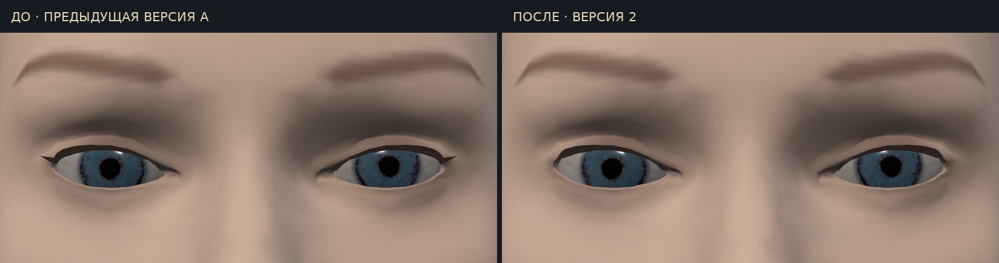
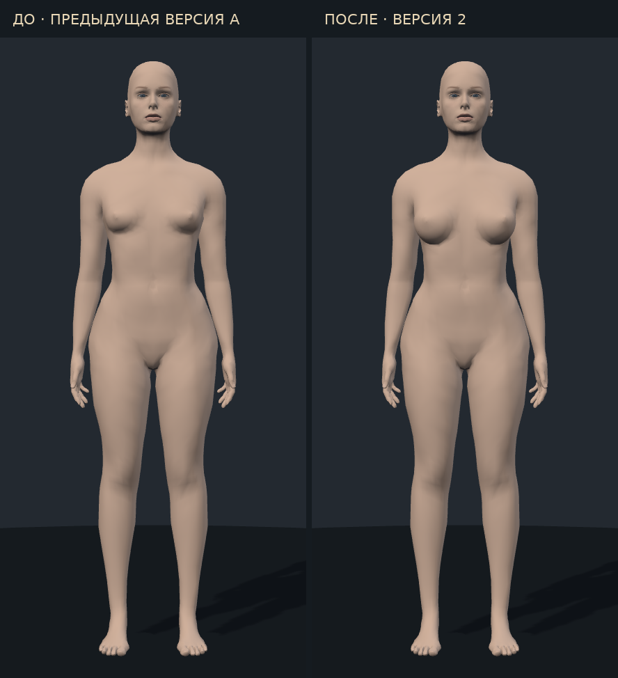
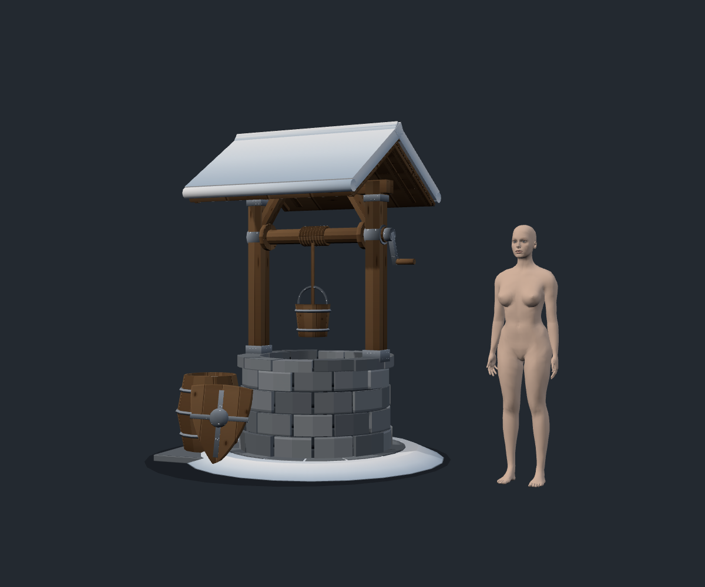

# Модель А — версия 2: верхние веки и форма груди

Это доработка **той же выбранной модели А**. На снимках слева — [предыдущая версия](../refined/), справа — новая; камера и свет в каждой паре одинаковые.

Отдельно подготовлена [не заменяющая эту версию проба более мягкой кожи и освещения](../relief-study/).

## Сравнение

**Глаза:** острые внешние стрелки убраны. Остались непрерывные линии на верхних веках без отдельных чёрных штрихов; голубые глаза сохранены.

[Лицо целиком](review/02-face-before-after.png)

**Фигура:** грудь увеличена, её поверхность в этой области локально сглажена. Брови, нос, уши, ягодицы, остальная форма тела и текстуры остались прежними.

[Торс спереди](review/03-torso-front-before-after.png) · [в три четверти](review/04-torso-angle-before-after.png) · [сбоку](review/05-torso-side-before-after.png)

[Фигура сбоку](review/07-figure-side-before-after.png) · [сзади](review/08-figure-back-before-after.png) · [ягодицы сбоку](review/09-hips-side-before-after.png)

**Сцена:** подробный колодец оставлен с прежним кодом и материалами; в новой витрине мужской модели нет.

[Общая сцена спереди](review/scene-front.png) · [колодец крупнее](review/well-angle.png)

## Скачать

- [Автономная 3D-витрина с моделью А и колодцем — ZIP](female_A_v2_and_detailed_well.zip?raw=1)
- [Отдельная модель А версии 2 — GLB](female_A_refined_v2.glb?raw=1)

Распакуйте ZIP и откройте `BladesOfWar_Showcase.html` в браузере с поддержкой WebGL. Интернет не нужен. Кнопки переключают модель, колодец, общую сцену и ракурсы; мышь вращает камеру, колесо меняет масштаб, правая кнопка сдвигает сцену. На странице GitHub HTML показывается как код, а не как интерактивная сцена.

Колодец создаётся исходным процедурным кодом внутри HTML; отдельного GLB колодца здесь нет. Предыдущая версия модели и исходные архивы не перезаписаны.

## Волосы — позже

Причёска **не добавлена**. Изученные варианты и рекомендации на следующий этап — в [HAIR_RESEARCH.md](HAIR_RESEARCH.md). Для игры предварительно предлагается отдельная шапочка волос и текстурированные пряди-карты; причёску, цвет и длину ещё нужно согласовать.

Модель пока статична: в GLB нет скелета, анимаций и морфов мимики, поэтому линии век и будущие волосы не будут автоматически двигаться с анимацией.

## Проверка и источник

Относительно предыдущей версии изменены только линии век и область груди; для округления силуэта в ней добавлены вершины. Поверхность вне затронутых граней, исходные UV, сетка голубых глаз, текстуры кожи и глаз сохранены. Проверены швы, отсутствие дыр и перевёрнутых граней. Khronos glTF Validator: **0 ошибок и 0 предупреждений**. Витрина проверена без сети на настольном и двух мобильных размерах экрана.

Для формы груди использованы CC0-данные MakeHuman из зафиксированного коммита; лицензия включена в ZIP. Исходные файлы, точные коэффициенты и команды повторной сборки — в [описании инструмента](../../../../tools/model-a-revision/README.md).
