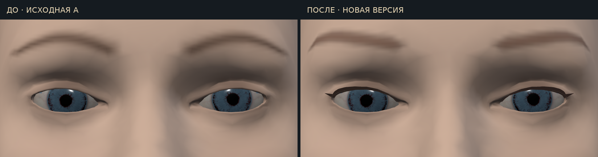
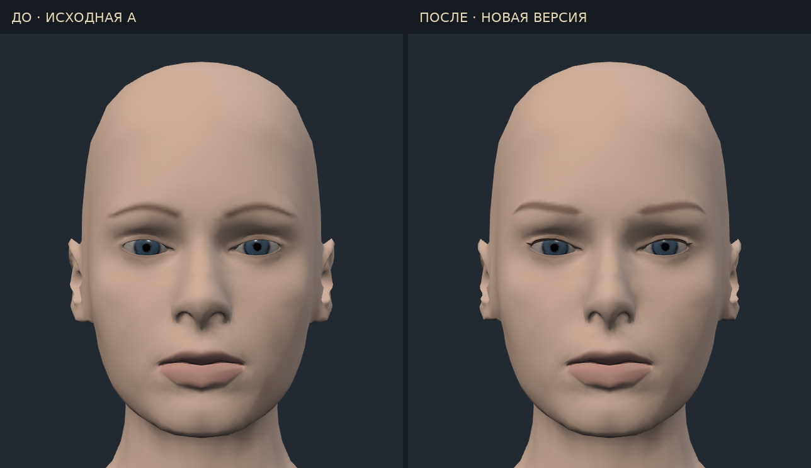
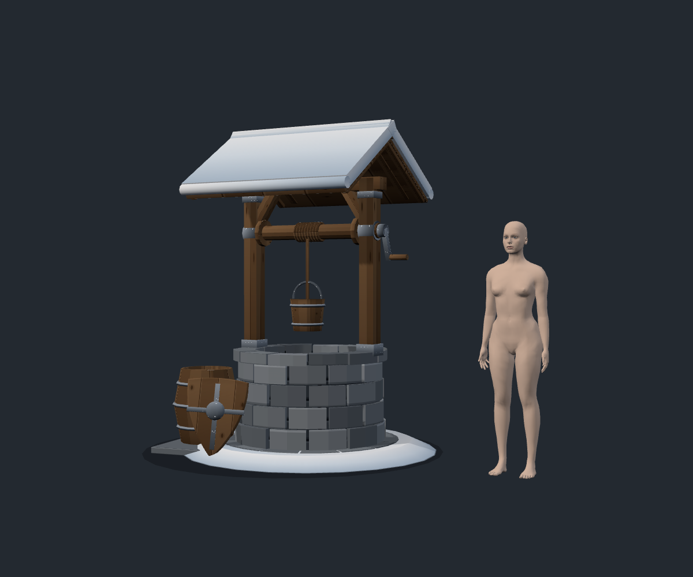

# Женщина А и подробный колодец

> **Более поздняя версия:** [модель А с линиями век без стрелок и увеличенной грудью](../refined-v2/). Эта страница и файлы ниже сохранены для сравнения.

Это новая версия выбранной голубоглазой **модели А**, а не другая женская модель. Для удобства сравнения слева на снимках — исходная А до ресниц, справа — новая версия. Камера и освещение в каждой паре одинаковые; изменения тела сделаны умеренно.

## Посмотреть

**Глаза и брови:** вместо прежних отдельных чёрных штрихов — сплошные кошачьи линии с вытянутыми уголками. Голубые глаза сохранены.

[Сравнить именно с предыдущей пробой ресниц со штрихами](review/11-previous-lashes-before-after.png)

**Лицо:** перерисованы брови, немного сужен нос и поправлена форма ушей.

[Лицо в три четверти](review/03-face-angle-before-after.png) · [Профиль и ухо](review/04-profile-before-after.png)

**Фигура:** немного изменена форма груди и уменьшен объём ягодиц. Прическу не добавляли, остальные части исходной модели не перерабатывались.

[В полный рост спереди](review/05-figure-front-before-after.png) · [сбоку](review/06-figure-side-before-after.png) · [сзади](review/07-figure-back-before-after.png)

[Торс спереди](review/08-torso-front-before-after.png) · [торс сбоку](review/09-torso-side-before-after.png) · [силуэт ягодиц сбоку](review/10-hips-side-before-after.png)

**Общая сцена:** взят подробный колодец из последнего архива, с его исходной геометрией и материалами; мужской модели в этой новой витрине нет.

[Общая сцена спереди](review/scene-front.png) · [Колодец крупнее](review/well-angle.png) · [Колодец спереди](review/well-front.png)

## Скачать и открыть

- [Скачать автономную 3D-витрину: женщина и колодец — ZIP](female_A_and_detailed_well.zip?raw=1)
- [Скачать отдельно женскую модель — GLB](female_A_refined.glb?raw=1)

Распакуйте ZIP и откройте `BladesOfWar_Showcase.html` в современном браузере с WebGL. Интернет не требуется. Кнопки переключают женщину, колодец, общую сцену и ракурсы; мышь вращает камеру, колесо меняет масштаб. GitHub показывает HTML как исходный код, поэтому файл нужно открыть **после скачивания и распаковки**, а не на странице GitHub.

Колодец создаётся внутри HTML исходным кодом из последней витрины, а не входит в женский GLB отдельной моделью. Предыдущие архивы и мужская модель в репозитории не удалены.

**Ограничение:** женская модель статична — скелета, анимаций и морфов мимики в ней нет. Новые ресницы не будут автоматически следовать за веками при будущей анимации.

## Источники и проверка

Основой служит [исходная модель А из коммита b093a005](https://github.com/IAmStarhead/Blades-Of-War/blob/b093a0052a6be080d0364c8a5136cf74ae53dff3/assets/models/female_fixed.glb). Для локальных изменений использованы CC0-данные [MakeHuman](https://github.com/makehumancommunity/makehuman/tree/a8bc2d54ff0ac92e78ff71431b1023eda42bf482/makehuman/data/targets); лицензия приложена к ZIP. При работе также изучались фотографии лица и материалы по анатомии; сами фотографии в результат не копировались. Ссылки и метод — в [описании сборки](../../../../tools/model-a-refinement/README.md).

Проверены локальность изменений, сохранение геометрии и текстуры глаз, целостность швов и отсутствие перевёрнутых треугольников. glTF Validator: **0 ошибок, 0 предупреждений**. Витрина проверена без сети, включая кнопки и мобильные размеры.
