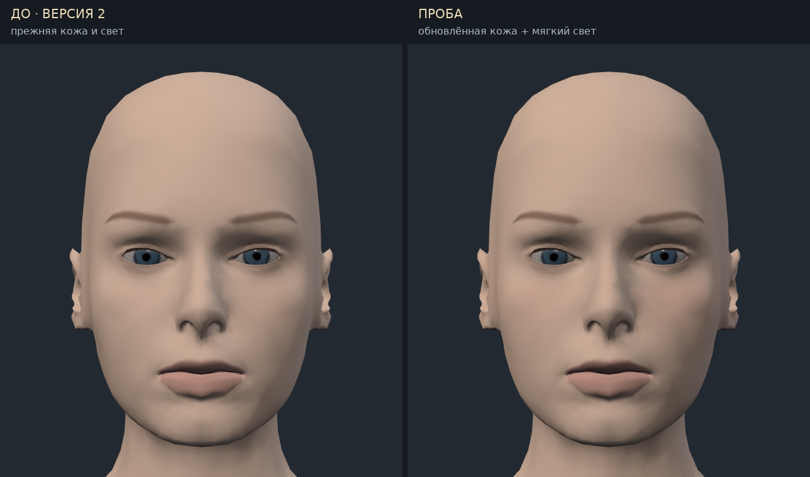
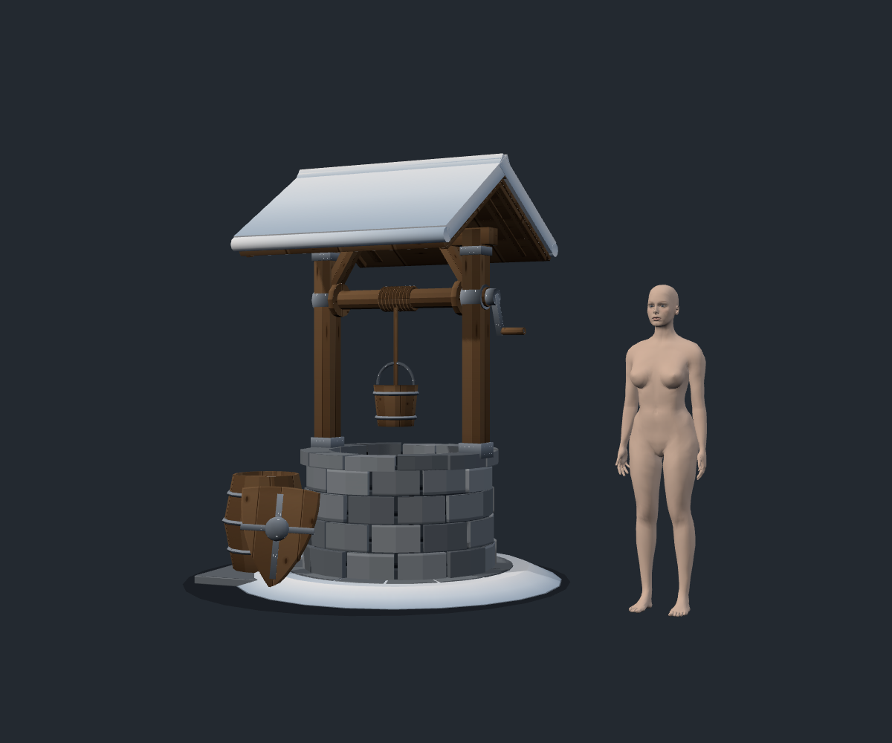

# Ева — проба кожи и освещения

Это **отдельный эксперимент** на выбранной модели А, а не замена [предыдущей версии 2](../refined-v2/). Форма тела и лица не менялась; волосы не добавлены. Изменения намеренно небольшие. На его основе позже подготовлена отдельная [проба бровей, моргания и кулаков](../motion-study/); эта версия сохранена.

## Посмотреть до и после

На каждой паре — настоящие снимки 3D-модели с одинакового ракурса, не рисунок и не AI-концепт. Слева прежняя кожа и свет, справа новая кожа и мягкий свет витрины:

[В полный рост](review/02-figure-before-after.png) · [В три четверти](review/03-figure-angle-before-after.png) · [Торс спереди](review/04-torso-before-after.png) · [Торс в три четверти](review/05-torso-angle-before-after.png) · [Со спины](review/06-back-before-after.png)

Изменения можно посмотреть и по отдельности: [только кожа при одинаковом освещении](review/07-skin-only-face.png) · [только освещение на одной и той же модели](review/08-light-only-torso.png). Оттенок кожи изменён очень мягко — разница не должна выглядеть как новый макияж или реалистичные поры.

Колодец сохранён:

[Общая сцена спереди](review/scene-front.png) · [Колодец отдельно](review/well-angle.png)

## Открыть в 3D

- [Скачать автономную витрину с Евой и колодцем — ZIP](female_A_skin_relief_and_well.zip?raw=1)
- [Скачать отдельную модель с обновлённой кожей — GLB](female_A_skin_relief.glb?raw=1)

Распакуйте ZIP и откройте `BladesOfWar_Showcase.html` в браузере с поддержкой WebGL — интернет не нужен. Выберите **«Женщина А»**: флажком **«Мягкий свет для Евы»** можно сравнить освещение. Он действует только при отдельном просмотре Евы. В режимах **«Колодец»** и **«Вместе»** свет автоматически остаётся прежним, чтобы не менять вид колодца. Мышь вращает камеру, колесо меняет масштаб, правая кнопка сдвигает сцену; на телефоне можно вращать пальцем и менять масштаб двумя пальцами.

На GitHub HTML показывается как код; интерактивно он работает после распаковки. Колодец создаётся внутри витрины, отдельного GLB колодца нет.

## Что изменено и сколько это стоит

- В самом **GLB** чуть разнообразили цвет существующей картинки кожи: без пор, фотографий и новых текстур. Брови, голубые глаза и гладкие линии век сохранены. Модель остаётся статичной — скелета и анимаций нет.
- Геометрия, силуэт и число треугольников **не изменились: 31 066**. Картинка кожи имеет прежний размер 1024 × 1024, поэтому объём памяти под неё остаётся примерно тем же; файл GLB стал больше примерно на 50 КБ из-за изменившегося сжатия.
- **Свет находится только в витрине, не внутри GLB.** Для игры похожий свет нужно отдельно настроить в игровом движке; итоговый вид будет зависеть от освещения сцены. Здесь перенастроены уже существующие источники: новых источников, дополнительных карт и проходов теней не добавлено.
- Предыдущая модель и её архив не перезаписаны. В этой пробе никаких новых причёсок нет.

Проверены сохранность геометрии и глаз, цвет на стыках кожи, целостность ZIP, работа офлайн и размеры двух мобильных экранов. Для GLB: **0 ошибок и 0 предупреждений** Khronos glTF Validator. Код колодца не изменён; при одинаковых ракурсах его изображение в отдельном режиме и в общей сцене (с временно скрытой Евой) совпало с прежним попиксельно. Подробности и сборка — в [описании инструмента](../../../../tools/model-a-relief/README.md).
