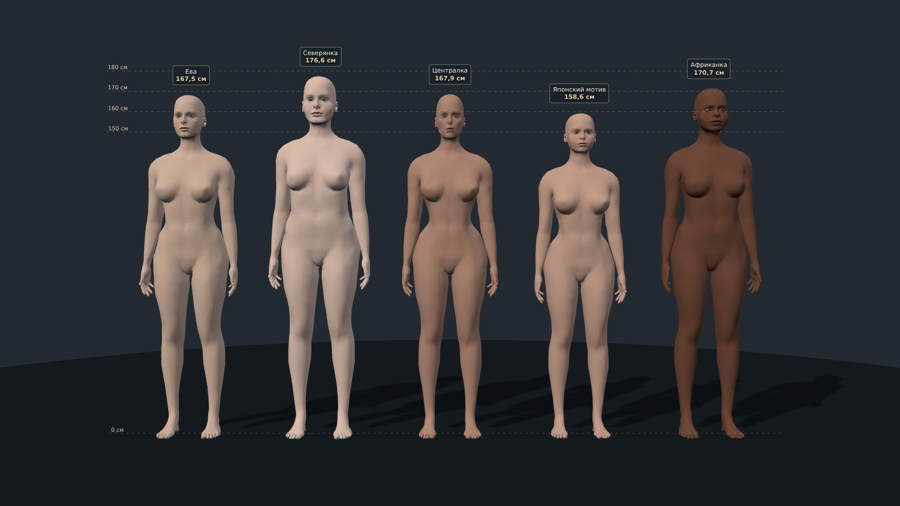

# Ева и четыре переработанные женские пробы

Ева остаётся базовой женщиной. Рядом с ней — **четыре отдельные взрослые художественные пробы**, в том числе добавленная африканка. Это новая версия для обсуждения: исходная Ева и [предыдущие три пробы](../women-variants/) не перезаписаны.

## Посмотреть и сравнить

[Сбоку](review/02-comparison-side.png) · [Сзади](review/03-comparison-back.png) · [Лица спереди](review/04-faces-front.png) · [Лица в три четверти](review/05-faces-angle.png) · [Закрытые глаза](review/06-blink.png)

- **[Скачать общую автономную 3D-витрину и пять GLB — ZIP](five_women_comparison_and_well.zip?raw=1)**
- Отдельно: [северянка](woman_north_v2.glb?raw=1) · [централка](woman_central_v2.glb?raw=1) · [японский мотив](woman_east_asian_v2.glb?raw=1) · [африканка](woman_african_v2.glb?raw=1) · [Ева, неизменённая основа](../selected-a/eye-study/female_A_eyes_refined.glb?raw=1)

Распакуйте архив и откройте `BladesOfWar_Showcase.html` в браузере с WebGL. Интернет не нужен. Сначала показаны все пять моделей **рядом на общем уровне пола**, с одной камерой, подписями и шкалой роста. Кнопки «Сбоку» и «Сзади» поворачивают каждую фигуру на месте, не пряча остальных друг за другом. Выберите персонажа для крупного плана; «Сравнить рост» возвращает всех в сцену. Мышь вращает камеру, колесо масштабирует; на телефоне используйте один или два пальца. Первая загрузка пяти моделей может занять несколько секунд.

Кадры трёх общих ракурсов — из одной 3D-сцены. Панели лиц составлены из отдельных кадров с одинаковым относительно роста масштабом камеры: они удобны для сравнения черт, **не** для сравнения роста. Рисунок на рендерах не дорисовывался.

## Что изменено

| Модель | Приблизительный рост | Изменения в этой индивидуальной пробе |
|---|---:|---|
| Ева | 167,5 см | Неизменённая основа: исходный оттенок кожи и голубые глаза. |
| Северянка | 176,6 см | Более светлая кожа, зеленоватая радужка, иная форма головы и лица; более широкий силуэт корпуса. |
| Централка | 167,9 см | Более тёплый и тёмный оттенок кожи, янтарно-карие глаза, более узкое лицо и талия, иной объём корпуса. |
| Японский мотив | 158,6 см | Тёплый оттенок кожи, карие глаза, более короткая и широкая голова, изменённые веки и более узкий корпус. |
| Африканка | 170,7 см | Глубокий тёплый оттенок кожи, карие глаза, индивидуальные пропорции лица, губ и корпуса. |

Лица теперь различаются не только носом и челюстью: изменены пропорции головы, области скул, глаза и/или веки, губы и цвет глаз. Корпус также меняется в области талии, живота и нижней части грудной клетки, а не только в груди и ягодицах. Цвет кожи нанесён на всю кожную текстуру, включая руки и ноги, чтобы не получить цветовые швы. Брови используют исходный рисунок; волос и одежды пока нет.

Оттенки и черты выбраны **для этих конкретных персонажей**. Они не являются универсальным описанием народов, Японии или Африки; внутри любой группы внешность разнообразна.

Готовые руки, кисти и нижняя часть ног не переделаны в локальной сетке; форма ягодиц плавно переходит в верхнюю часть бедра. Рост задан равномерным масштабом **всего** персонажа относительно Евы: северянка 105%, централка 100%, японский мотив 95%, африканка 102%. Поэтому конечности физически тоже масштабируются, но их локальные формы не переработаны. Высоты в таблице измерены от пола до макушки и учитывают и масштаб, и изменение головы.

## Ограничения и проверки

Моргание и предварительный парный сгиб кистей сохранены; полноценного скелета, ходьбы и удара нет. Исходный открытый кулак имеет локальные контакты у больших пальцев. У исходного моргания уже есть контакты век; в промежуточном положении новая форма даёт и некоторые новые пары треугольников относительно Евы. Глаз и окружающая кожа также пересекаются на своей границе, и выбранные пары меняются. Это **не** утверждение, что анимация или вся модель свободна от пересечений.

Проверены совпадение защищённых локальных координат и нормалей конечностей, швы, вырожденные и перевёрнутые треугольники, выборочные контакты лица/груди/ягодиц и девять положений сгиба кистей; все пять GLB прошли Khronos glTF Validator без ошибок и предупреждений. Моргание и интерфейс проверены на отдельных положениях, автономная витрина — также на мобильном размере 390 px. Одежду, игровой импорт и всю непрерывную анимацию ещё нужно проверять. Детали, воспроизведение и ограничения тестов — [инструменты и QA](../../../tools/women-variants-v2/README.md).

Основа и отдельные формы используют ресурсы MakeHuman/MPFB2, CC0 1.0; текст лицензии приложен к архиву. Фотографии в модели и архив не включены. Прежние источники и оговорки — [исследование](../women-variants/RESEARCH.md).
