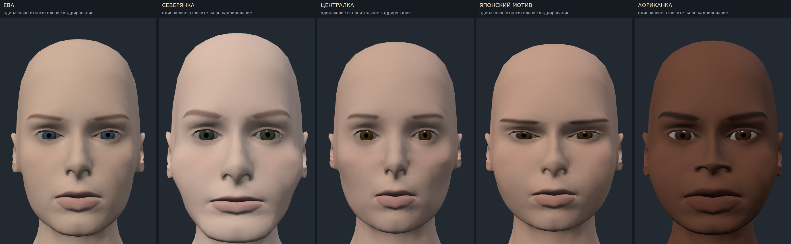

# Ева и четыре женские пробы — лица v3

Это отдельная переработка: Ева и [предыдущая версия v2](../women-variants-v2/) сохранены. Централке осветлена кожа и скорректированы пропорции головы; у четырёх вариантов отдельно изменены глаза, брови, уши и губы. Корпус и рост сохраняют различия предыдущей версии.

## Посмотреть и скачать

[Централка: до и после](review/10-central-before-after.png) · [Глаза и брови](review/07-eyes-and-brows.png) · [Уши](review/08-ears.png) · [Губы](review/09-lips.png) · [Лица в три четверти](review/05-faces-angle.png) · [Моргание](review/06-blink.png)

[Рост на общем полу: спереди](review/01-comparison-front.png) · [Сбоку](review/02-comparison-side.png) · [Сзади](review/03-comparison-back.png)

- **[Скачать автономную 3D-витрину и пять GLB — ZIP](five_women_face_details_and_well.zip?raw=1)**
- Отдельные файлы: [северянка](woman_north_v3.glb?raw=1) · [централка](woman_central_v3.glb?raw=1) · [японский мотив](woman_east_asian_v3.glb?raw=1) · [африканка](woman_african_v3.glb?raw=1) · [неизменённая Ева](../selected-a/eye-study/female_A_eyes_refined.glb?raw=1).

Распакуйте архив и откройте `BladesOfWar_Showcase.html` в браузере с WebGL — интернет не нужен. «Сравнить рост» показывает всех на общем полу со шкалой. Кнопки **«Сравнить лица»** и **«Сравнить уши»** выравнивают головы рядом; в этих двух режимах рост сравнивать нельзя. Выберите персонажа для отдельных крупных планов. Мышь вращает камеру, колесо масштабирует; на телефоне используйте пальцы.

Панели деталей составлены из настоящих 3D-кадров с одинаковыми светом и относительным кадрированием. В сравнении централки до/после камера и свет одинаковые; рисунок моделей на изображениях не дорисовывался. Цвет кожи может выглядеть иначе при другом освещении и на других экранах.

| Персонаж | Приблизительный рост | Что выделяется в этой пробе |
|---|---:|---|
| Ева | 167,5 см | Неизменённая основа. |
| Северянка | 176,6 см | Светлая кожа, более длинная дуга бровей, светлая радужка, крупнее уши и шире корпус. |
| Централка | 167,2 см | Более светлая, чем в v2; голова короче и шире, брови короче, форма глаз и мочек изменена. |
| Японский мотив | 158,6 см | Более прямые брови, индивидуальные веки и губы, более компактный корпус. |
| Африканка | 170,7 см | Тёмная кожа, более густой рисунок бровей, другие губы, глаза и мочки. |

Это конкретные художественные персонажи, а не универсальные правила внешности людей разных регионов. Брови нарисованы на текстуре; волос и одежды нет. Рост задан равномерным масштабом всей фигуры. Руки и область ниже `y=0,835 м` сохранены в локальной геометрии, а переход ягодиц затрагивает верхнюю часть бедра.

## Как работает кулак

**Костей пальцев в GLB нет.** Во вспомогательном риге была рассчитана форма сжатия, затем результат запечён в морфы: они перемещают вершины, а клипы меняют их веса. Обе кисти сгибаются синхронно. Для независимой анимации суставов, хватания оружия и полноценного боя понадобится отдельный скелетный риг.

Моргание и сгиб кистей предварительные. В исходной модели уже есть контакты у пальцев и век, а в некоторых промежуточных положениях моргания у новых вариантов появляются дополнительные пары контактов; граница глаза и кожи также меняется. Проверки выборочные и не гарантируют отсутствия пересечений во всех позах. Совместимость с одеждой и игровым движком пока не проверена.

Пять GLB прошли Khronos glTF Validator без ошибок и предупреждений; проверены защищённые конечности, швы, выбранные области лица, ушей, груди и ягодиц, а также автономная витрина на десктопе и телефоне. [Подробности сборки и ограничений](../../../tools/women-variants-v3/README.md). Основа и отдельные формы: MakeHuman/MPFB2 assets, CC0 1.0; лицензия включена в ZIP.
