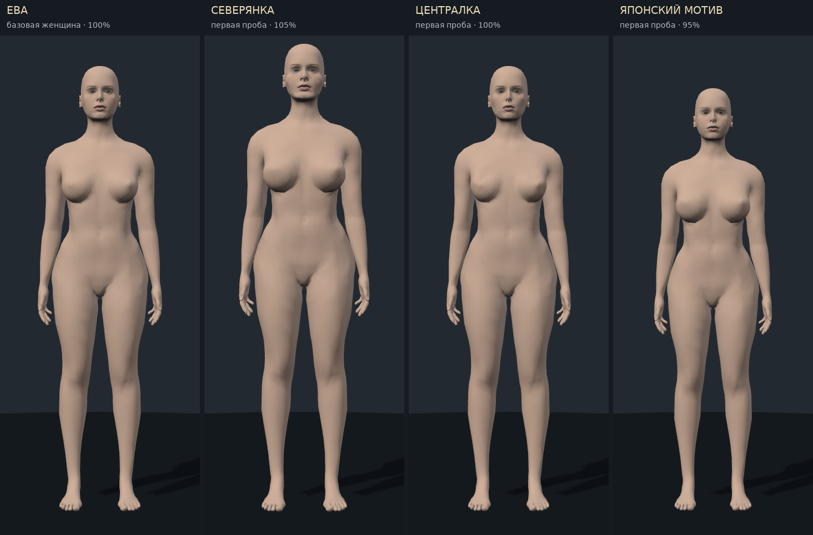

# Ева и первые женские варианты

Ева остаётся **женщиной по умолчанию**, а не представительницей отдельного народа. От [её пробы глаз](../selected-a/eye-study/) сделаны три **отдельных взрослых 3D-эскиза**. Это первые художественные варианты для обсуждения, не утверждённые каноны и не описание внешности всех людей соответствующих народов.

## Смотреть и сравнивать

[Сбоку](review/02-figure-side.png) · [Сзади](review/03-figure-back.png) · [Лица спереди](review/04-faces-front.png) · [Лица в три четверти](review/05-faces-angle.png) · [Моргание](review/06-blink.png)

Для роста использована одна и та же камера. Для крупных планов лица камера масштабируется вместе с моделью, чтобы удобнее было сравнивать черты. Это настоящие кадры из 3D-витрины, только обрезанные и подписанные; лица и тела на них не дорисованы.

- **Северянка:** выше Евы, более выражены скулы и нижняя часть лица, увеличены формы груди и ягодиц. Равномерный масштаб 105%, высота примерно 175,9 см.
- **Централка:** рост Евы, более сдержанные черты, немного уменьшена проекция груди и изменён объём ягодиц. Масштаб 100%, около 167,5 см.
- **Японский мотив:** ниже Евы, мягче отдельные черты лица, немного изменён рисунок век, грудь увеличена. Масштаб 95%, около 159,1 см. Тёмно-карие радужки выбраны для этой одной модели, не как обязательный признак.

Руки, кисти, основная форма ног и поза **не переработаны**. Граница формы ягодиц постепенно затухает к верхней части бедра; ниже этого перехода локальные координаты сохранены. Масштаб задаётся равномерно всему персонажу, поэтому более высокая модель физически больше целиком, но пропорции и готовые детали конечностей не меняются. Кожа и брови остаются исходными, причёсок пока нет.

**Ограничение замысла:** из-за требования сохранить остальные части тела северянка пока не стала заметно более мускулистой или полной, а централка — существенно тоньше в корпусе и конечностях. Если понадобится сильнее подчеркнуть это различие, сперва стоит отдельно согласовать изменения корпуса и/или плеч, не затрагивая готовые кисти и пальцы.

## 3D-файлы

- [Общая автономная витрина с Евой, тремя пробами и колодцем — ZIP](four_women_studies_and_well.zip?raw=1)
- [Северянка — GLB](woman_north_trial.glb?raw=1) · [Централка — GLB](woman_central_trial.glb?raw=1) · [Японский мотив — GLB](woman_east_asian_trial.glb?raw=1) · [Ева отдельно](../selected-a/eye-study/female_A_eyes_refined.glb?raw=1)

Распакуйте архив и откройте `BladesOfWar_Showcase.html` в браузере с WebGL — интернет не нужен. В блоке **«Персонаж»** переключайте модели; в блоке **«Сцена»** можно показать отдельно персонажа, колодец или их вместе. Первая загрузка каждой модели может занять несколько секунд. Выбирайте ракурсы и «Лицо крупно»; мышь вращает камеру, колесо меняет масштаб, на телефоне используйте один или два пальца. Доступны кнопки моргания и ползунок парного сгиба кистей.

## Ещё два направления для обсуждения

- **Арабски вдохновлённый образ:** например, взрослая женщина с тёплым оливковым или коричневым оттенком кожи, индивидуальной линией носа и выразительными бровями; форму лица и телосложение можно выбирать отдельно. Арабские общества разнообразны: это предложение одного образа, а не единый шаблон.
- **Африкански вдохновлённый образ:** например, взрослая женщина с глубоким тёплым оттенком кожи и собственными пропорциями скул, носа и губ. Африка очень разнообразна; при желании лучше разработать несколько индивидуальных лиц и оттенков вместо одного «общеафриканского» лица.

Эти два направления **пока только предложения**, 3D-моделей для них здесь нет. Цвета кожи, глаз и волосы можно согласовать отдельно. [Источники, анатомические оговорки и лицензии](RESEARCH.md).

## Что ещё не готово

У моделей нет скелета, ходьбы, удара или полного рига для игры; моргание и парный сгиб кистей — унаследованные морфы. Одежду, анимации, игровой импорт и возможные пересечения нужно проверять отдельно. Прежний пробный кулак остаётся округлым с некоторых сторон, в исходной открытой сетке есть локальные контакты у больших пальцев. Для ограниченных областей тела и девяти положений сгиба проверено отсутствие **новых выбранных пар** пересечений относительно Евы, но это не гарантия для всей сетки и всего движения. Все четыре файла прошли Khronos glTF Validator без ошибок и предупреждений. Подробности — [проверки и сборка](../../../tools/women-variants/README.md).
