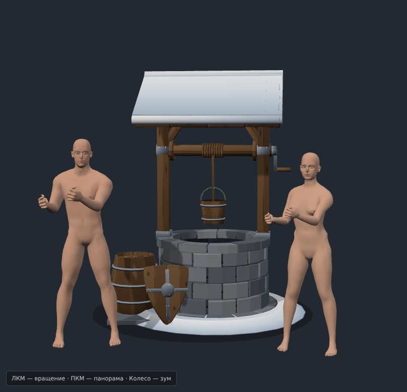
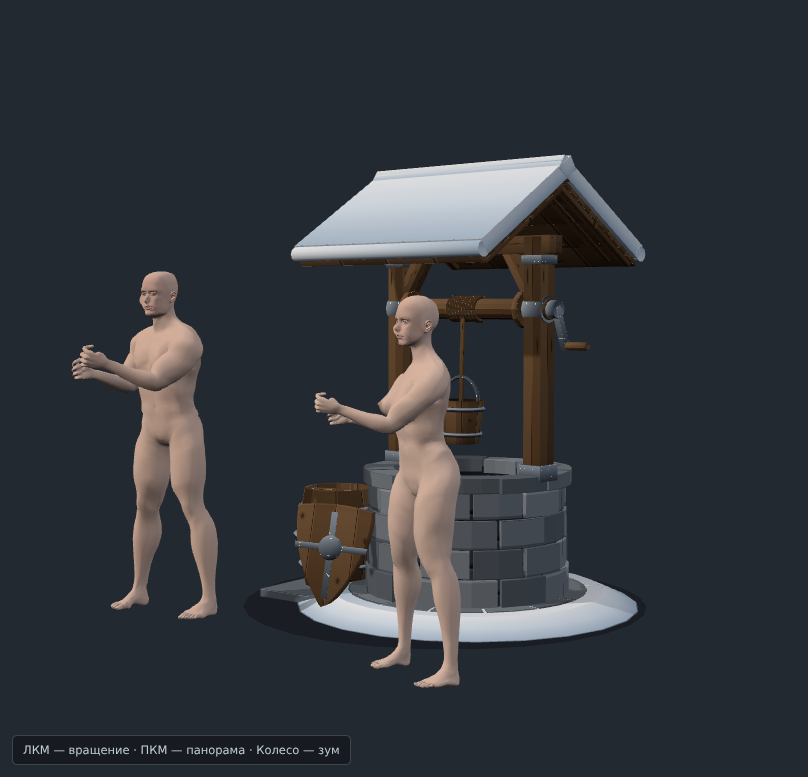

# Blades of War — Адам, Ева и колодец

Рабочая сборка 3D-витрины с исправлениями моделей. Исходный архив в репозитории не изменён; причёски не добавлялись.

## Как посмотреть

1. [Скачайте архив со сборкой](BladesOfWar_Adam_Eve_Showcase_Repaired.zip?raw=1).
2. Распакуйте его и откройте **BladesOfWar_Showcase.html** в современном браузере с поддержкой WebGL.
3. В витрине можно переключать персонажей, народность, позы рук, мимику и ракурсы. Для просмотра подключение к интернету не требуется.

GitHub сам по себе показывает HTML как файл, а не запускает интерактивную 3D-страницу, поэтому его нужно скачать и открыть в браузере. В архиве также находятся отдельные модели `assets/models/female_fixed.glb` и `assets/models/male_fixed.glb` для импорта в 3D-редактор.

## Контрольные изображения

Общая сцена:

Пара в другом ракурсе:

[Другие изображения лиц, кистей и профилей](review/) · [Отчёт о проверках](QA.md)

## Важные ограничения

Это промежуточная, не финальная production-модель. Кулаки пока разжаты и требуют ручной доводки. В исходных моделях нет клипов ходьбы или бега; они не создавались. Переключение народов, масштаба и готовых поз работает в HTML-витрине, но не воспроизводится автоматически при обычном импорте GLB.
