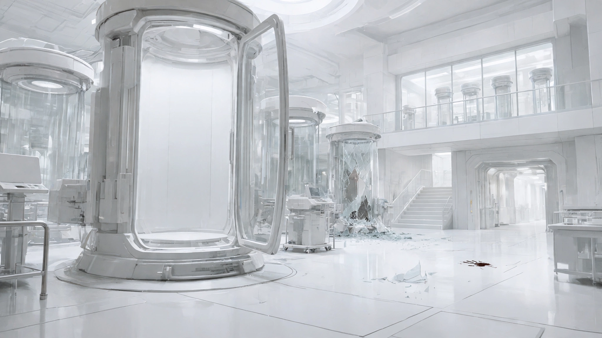
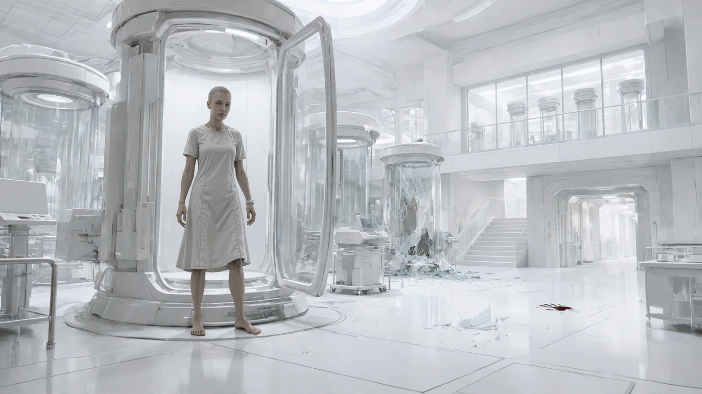
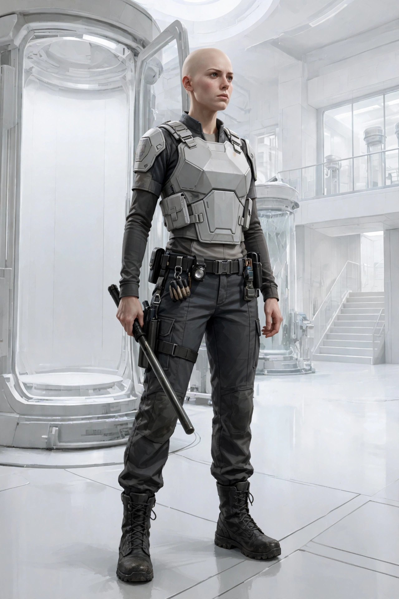

# Белые лаборатории и Ева — визуальные пробы

Изображения ниже созданы нейросетью и выбраны из предложенных вариантов. Это **концепт-арты для обсуждения**, а не кадры готовой игры, точный план уровней или утверждённый дизайн. Лица на пробах Евы не являются рендерами нашей 3D-модели и могут отличаться от неё.

## 1. Зал с колбами

[Открыть изображение в полном размере](02-white-pod-chamber.png)

Проба помещения, где могла бы проснуться Ева: светлая клиническая архитектура, большие колбы, лестница к наблюдательному уровню и следы произошедшего. Крови на изображении немного — её количество и вид ещё обсуждаются.

## 2. Многоуровневый исследовательский зал

[Открыть изображение в полном размере](03-white-research-hub.png)

Проба центрального пространства с лестницей, прозрачным лифтом, балконом и дверями в разные секции. В одной колбе нейросеть добавила размытый силуэт; это **не утверждённый облик мутанта**.

## 3. Ева в сорочке пациентки

[Открыть изображение в полном размере](04-eva-patient-gown.png)

Проба начала истории: Ева — подопытная, а не медработница. Сорочка на изображении получилась примерно до колен, хотя пользователь представлял длинное платье; длину и фасон ещё нужно уточнить.

## 4. Ева в возможной форме охраны

[Открыть изображение в полном размере](05-eva-security-uniform.png)

Поздний вариант на основе пользовательской идеи переодеться в форму охраны. Фасон, дубинка, время получения и внешний вид не утверждены. Обе картинки Евы — нейроконцепты, а не изменения исходной модели или обещание игровой графики. Дополнительные референсы и заметки — в [исследовании дизайна героини](../CHARACTER_DESIGN.md).

В качестве визуального референса для светлой лаборатории использовалась [фотография декорации с капсулами «Аркадии» из фильма Resident Evil: Afterlife](https://www.takudazai.com/post/47462524334/arcadia-pods-from-resident-evil-afterlife-welded). Фотография в репозиторий не включена. Цель — передать ощущение чистого белого футуризма и его контраст с ужасом, а не копировать чужие декорации или персонажей.

[Вернуться к концепции игры](../README.md)
