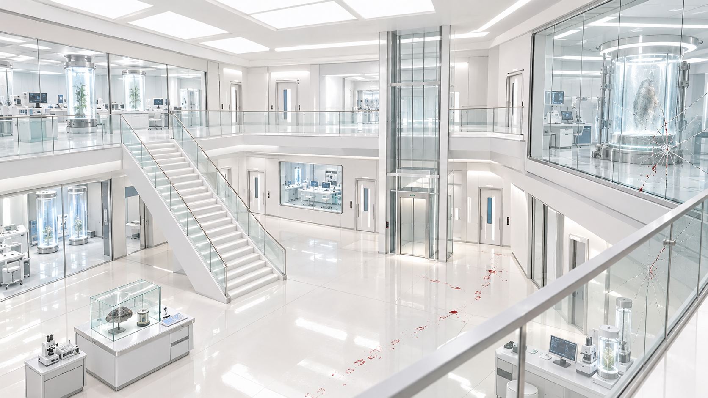

# Белые лаборатории — визуальные пробы

Два изображения ниже созданы нейросетью после уточнения художественного направления. Это **концепт-арты для обсуждения**, а не кадры готовой игры, точный план уровней или утверждённый дизайн.

## 1. Зал с колбами

[Открыть изображение в полном размере](02-white-pod-chamber.png)

Проба помещения, где могла бы проснуться Ева: светлая клиническая архитектура, большие колбы, лестница к наблюдательному уровню и следы произошедшего. Крови на изображении немного — её количество и вид ещё обсуждаются.

## 2. Многоуровневый исследовательский зал

[Открыть изображение в полном размере](03-white-research-hub.png)

Проба центрального пространства с лестницей, прозрачным лифтом, балконом и дверями в разные секции. В одной колбе нейросеть добавила размытый силуэт; это **не утверждённый облик мутанта**.

В качестве визуального референса для светлой лаборатории использовалась [фотография декорации с капсулами «Аркадии» из фильма Resident Evil: Afterlife](https://www.takudazai.com/post/47462524334/arcadia-pods-from-resident-evil-afterlife-welded). Фотография в репозиторий не включена. Цель — передать ощущение чистого белого футуризма и его контраст с ужасом, а не копировать чужие декорации или персонажей.

[Вернуться к концепции игры](../README.md)
